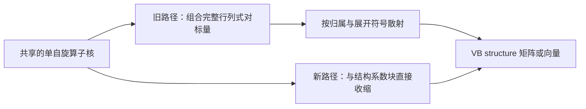

# 从 unique-spin-string 直接收缩到 VB structure

算法说明 · 审阅稿 · 2026-10-07

## 1. 结构矩阵元的计算

VB 结构由成键模式和自旋耦合定义。一个结构通常包含许多完整行列式展开项；不同结构的展开项，又大量复用相同的单自旋占据串。

传统实现先计算单自旋核，再组合完整行列式对的矩阵元，最后根据展开系数累加到结构矩阵。不同结构共享同一展开项时，还需要查询该项的结构归属，分别累加。

本文将展开系数写成 spin-string 系数块，把上述求和重排为矩阵收缩。固定轨道、积分和结构列表后，两种计算给出相同的结构 H/S；区别在于求和顺序和中间量。



XMVB4.0 的普通 RDM–VBSCF 已复用 unique-spin-string 核，也没有保存完整的行列式 H/S 数值矩阵。下文的比较针对核之后的 pair 组合与结构散射，而不是单自旋核的计算。

## 2. 三个层级

| 层级 | 表示什么 | 在本文算法中的作用 |
| --- | --- | --- |
| VB structure | 指定的成键／自旋耦合波函数构件 | 真正的结构系数变分空间 |
| 完整 determinant | 一条 α 串与一条 β 串组成的展开项 | 描述结构展开的组合关系，不必成为数值矩阵元中间层 |
| unique-spin-string | 去重后的单自旋占据串 | 共享单自旋算子核的索引空间 |

在固定、非正交轨道下，记 α、β 串分别为 $a$、$b$，结构编号为 $I$。采用实数系数约定：

$$
|\Phi_I\rangle
=\sum_{a,b}(C_I)_{ab}|a_\alpha b_\beta\rangle,
\qquad
|\Psi\rangle=\sum_I v_I|\Phi_I\rangle.
$$

$C_I$ 由结构定义确定。轨道固定时，变分参数仍是结构系数 $v_I$。

因此，结构向量 $v$ 对应的 string-product 系数为

$$
X(v)=\sum_I v_I C_I.
$$

$X$ 是结构向量的内部表示；算子作用后，结果再投影回所选结构空间。

## 3. 两对 singlet 的例子

### 3.1 结构展开与费米符号

考虑四个轨道上的两对 singlet。定义未归一化配对产生算符

$$
P_{ij}^{\dagger}
=a_{i\alpha}^{\dagger}a_{j\beta}^{\dagger}
-a_{i\beta}^{\dagger}a_{j\alpha}^{\dagger}.
$$

选择结构

$$
|\Phi_A\rangle=-P_{12}^{\dagger}P_{34}^{\dagger}|0\rangle.
$$

约定完整行列式的产生算符按“α 在前、β 在后；各自轨道编号升序”排列。上式的整体负号只用于选择统一的结构相位；不能忽略重排产生算符产生的费米符号。

| 展开项 | α 占据串 | β 占据串 | 系数 |
| --- | --- | --- | ---: |
| $D_1$ | $(1,3)$ | $(2,4)$ | $+1$ |
| $D_2$ | $(1,4)$ | $(2,3)$ | $+1$ |
| $D_3$ | $(2,3)$ | $(1,4)$ | $+1$ |
| $D_4$ | $(2,4)$ | $(1,3)$ | $+1$ |

这个结构包含 4 个完整展开项，以及各 4 条 unique α、β strings。

### 3.2 系数矩阵

按如下局部顺序排列：

$$
\alpha_A=(13,14,23,24),\qquad
\beta_A=(24,23,14,13).
$$

那么

$$
C_A=\begin{pmatrix}
1&0&0&0\\
0&1&0&0\\
0&0&1&0\\
0&0&0&1
\end{pmatrix}.
$$

由于 β 列按与 α 行匹配的顺序排列，$C_A$ 恰为单位矩阵。一般结构的 $C_I$ 是带符号的稀疏矩阵。此例的非零连接为：

```text
α13 ──(+1)── β24
α14 ──(+1)── β23
α23 ──(+1)── β14
α24 ──(+1)── β13
```

第二个结构可选

$$
|\Phi_B\rangle=-P_{13}^{\dagger}P_{24}^{\dagger}|0\rangle.
$$

其展开是：

| α 占据串 | β 占据串 | 系数 |
| --- | --- | ---: |
| $(1,2)$ | $(3,4)$ | $+1$ |
| $(1,4)$ | $(2,3)$ | $-1$ |
| $(2,3)$ | $(1,4)$ | $-1$ |
| $(3,4)$ | $(1,2)$ | $+1$ |

结构 A、B 的局部 string 列表不同。交叉矩阵元使用的核，应按左、右局部列表分别取行、列；也可将两个系数矩阵嵌入统一的全局 string 索引。

## 4. 重叠：从四重求和到直接结构收缩

### 4.1 原始表达式

定义未归一化单自旋重叠核

$$
S^\alpha_{aa'}=\langle a_\alpha|a'_\alpha\rangle,
\qquad
S^\beta_{bb'}=\langle b_\beta|b'_\beta\rangle.
$$

完整展开项之间的重叠为两者的乘积。因此

$$
S_{IJ}
=\sum_{a,a',b,b'}
(C_I)_{ab}S^\alpha_{aa'}(C_J)_{a'b'}S^\beta_{bb'}.
$$

旧的组织方式可以逐个构造
$S^\alpha_{aa'}S^\beta_{bb'}$，再乘结构系数、累加。两对 singlet 的结构自重叠有 16 个有序展开项对；实际实现可以进一步利用对称性。

### 4.2 精确重排求和

先对右侧 β 指标求和，再处理 α 指标：

$$
W=C_J(S^\beta)^T,\qquad
Y=S^\alpha W.
$$

用实数 Frobenius 内积

$$
\langle L,R\rangle_F=\operatorname{Tr}(L^T R)
=\sum_{a,b}L_{ab}R_{ab},
$$

就得到核心公式

$$
\boxed{S_{IJ}=\langle C_I,S^\alpha C_J(S^\beta)^T\rangle_F.}
$$

| 中间量 | 左右结构局部 support 下的形状 |
| --- | --- |
| $C_J$ | $U_{\alpha,J}\times U_{\beta,J}$ |
| $S^\alpha$ | $U_{\alpha,I}\times U_{\alpha,J}$ |
| $S^\beta$ | $U_{\beta,I}\times U_{\beta,J}$ |
| $W$ | $U_{\alpha,J}\times U_{\beta,I}$ |
| $Y$ | $U_{\alpha,I}\times U_{\beta,I}$ |

展开项没有减少，但逐项乘积被重新组织为两次收缩和一次结构投影。稀疏系数块可进一步使用专门的收缩实现。

## 5. Hamiltonian 收缩

### 5.1 一电子与 same-spin 双电子通道

记 $H^\alpha$、$H^\beta$ 包含各自的有效一电子及同自旋双电子贡献，则

$$
H^{\mathrm{same}}_{IJ}
=\left\langle C_I,
H^\alpha C_J(S^\beta)^T
+S^\alpha C_J(H^\beta)^T
\right\rangle_F.
$$

不活性空间的标量能量贡献为 $E_{\mathrm{core}}S_{IJ}$，与上述有效核一并构成 Hamiltonian。

### 5.2 Opposite-spin 通道

定义未除以 string overlap 的单自旋跃迁密度核

$$
D^{\sigma,ij}_{aa'}
=\langle a_\sigma|a_{i\sigma}^{\dagger}a_{j\sigma}|a'_\sigma\rangle.
$$

将轨道对 $(i,j)$ 简记为通道 $p$，并将积分及所选索引约定包含在 $V_{pq}$ 中，则

$$
H^{\mathrm{opp}}_{IJ}
=\sum_{p,q}V_{pq}
\left\langle C_I,
D^{\alpha,p}C_J(D^{\beta,q})^T
\right\rangle_F.
$$

因此，一条通用通道都具有

$$
F_{IJ}=\langle C_I,A C_J B^T\rangle_F
$$

的形式。Exact 与 RI 的区别体现在积分通道的表示和应用；两端的结构投影相同，各通道的成本则需分别分析。

## 6. 结构空间的 Davidson action

真正要求解的广义本征问题是

$$
H_{\mathrm{str}}v=E S_{\mathrm{str}}v,
\qquad v\in\mathbb R^{N_{\mathrm{str}}}.
$$

不必先组装完整结构 H/S，就可以对结构向量执行：


对 overlap 而言：

$$
X=\sum_J v_J C_J,\qquad
Y_S=S^\alpha X(S^\beta)^T,\qquad
(Sv)_I=\langle C_I,Y_S\rangle_F.
$$

Hamiltonian 按上述物理通道累加，得到 $Y_H$，再计算

$$
(Hv)_I=\langle C_I,Y_H\rangle_F.
$$

这就是所选结构子空间上算子的 expand–action–project 表示。内部 image 可以落在结构映射的像空间之外；最后的投影仍使用原来的 $C_I$，因此不要求所选结构对内部操作闭合。

概念伪码如下。它说明线性映射，不要求实现分配完整的稠密中间量：

```text
apply_structure_block(V):
    X = expand_selected_structures(V)
    Y_H, Y_S = zero_images()

    for each physical channel:
        accumulate_string_action(X, Y_H, Y_S)

    return project_to_selected_structures(Y_H, Y_S)
```

| 核对的模块 | 求解空间 | 方法 |
| --- | --- | --- |
| XMVB4.0 普通 RDM–VBSCF | VB structure | dense 广义对角化 |
| XMVB4.0 FCI 模块 | 完整 determinant | Davidson |
| 本项目 VBSCF Davidson | 所选 VB structure | matrix-free Davidson |

这里比较的是两个不同的本征问题：FCI 的未知量是完整行列式系数，selected-VB 的未知量是给定结构列表的系数。

## 7. Backward：直接生成单自旋核的反向权重

考虑实数通用收缩

$$
F=\langle L,A R B^T\rangle_F.
$$

固定 $L,R$，其微分为

$$
dF=\langle L,(dA)R B^T+A R(dB)^T\rangle_F.
$$

通过迹的循环性质得到

$$
\boxed{\overline A=\frac{\partial F}{\partial A}=LBR^T,\qquad
\overline B=\frac{\partial F}{\partial B}=L^TAR.}
$$

结构层的反向权重由系数块收缩到 α、β 核，省去了完整行列式对导数的组合与散射。

对于归一化、驻定的单态结构系数 $v$，固定点能量导数包含

$$
dE=v^T(dH-E\,dS)v.
$$

态平均按态权重组合各态贡献。以上 adjoint 给出收缩对核的导数；继续对核及轨道坐标求导，才得到轨道梯度。

HVP 可以继续对收缩求方向微分。例如

$$
\dot{\overline A}
=\dot LBR^T+L\dot B R^T+LB\dot R^T.
$$

完整 HVP 还包含核的方向响应、结构系数响应与轨道坐标的微分。上述公式说明这些响应所需的收缩可以沿同一计算图求导。

## 8. 分块计算与内存

上述矩阵公式说明代数，不强制保存所有 string-pair 核。可以按核块生成和消费：

```text
for each spin-pair tile:
    generate the kernels required by this tile
    contract with the relevant coefficient support / input block
    accumulate structure images or kernel adjoints
    release or reuse tile workspace
```

Tile 的关键是让核在有效生命周期内完成所有必要消费，避免为了省内存而在多个消费者中重复生成。具体通道可能需要不同的 sweep 和 workspace；这个伪码不是声称所有消费者已经融合为一次遍历。

| 对象 | 可行的组织方式 | 仍需警惕 |
| --- | --- | --- |
| 单自旋 pair 核 | 按 tile 生成／消费 | 全局 accepted 或 directional cache |
| 单个结构的展开系数 | 稀疏连接与局部 support | 初始化的展开项数量 |
| Davidson 输入与 image | block action、分块投影 | 完整 spin-product carrier 的尺寸 |
| 结构 H/S | matrix-free action | dense 对照路径仍需要结构矩阵 |

Tile 能限制局部 pair 载荷，但不自动证明整个程序内存与 $U_\alpha,U_\beta$ 无关。

## 9. 计算成本

### 9.1 单通道 action

对完整稠密 spin-product 输入，单通道逐 pair 应用可有

$$
O(U_\alpha^2U_\beta^2)
$$

成本。将同一通道写成 $A X B^T$ 后，稠密矩阵计算成本为

$$
O(U_\alpha^2U_\beta+U_\alpha U_\beta^2).
$$

若 $U_\alpha\sim U_\beta\sim U$，这一特定 action 从四次变为三次复杂度。Davidson block width 为 $b$ 时，上述算术量相应乘以 $b$。

这个比较不包括核生成、通道数量、积分应用及完整梯度/HVP 成本。也不能把完整稠密输入的比较直接套到一个稀疏单结构自矩阵元上。

### 9.2 结构展开与 string 空间的增长

对由 $n$ 对不相交 singlet 构成的单结构，一般有 $2^n$ 个展开项；这种例子本身也有 $2^n$ 条 α strings 和 $2^n$ 条 β strings。

直接收缩减少了数值热路径中的逐对组合、查询和散射，并便于跨结构复用。但 unique-string 数量和初始化展开仍可能随活性空间指数增长。该方法降低了给定 string 空间上的收缩成本，并未消除表示空间本身的增长。

总耗时还取决于核生成、积分通道和响应计算。性能测试应分别记录收缩内核与端到端耗时。

## 10. 数值检查

对第 3 节的结构 A、B，取正定、非正交的单电子重叠矩阵

$$
O=\begin{pmatrix}
1&0.18&0.07&0.03\\
0.18&1&0.11&0.06\\
0.07&0.11&1&0.16\\
0.03&0.06&0.16&1
\end{pmatrix}.
$$

由相应占据子矩阵的行列式构造单自旋重叠核，分别采用完整展开求和与矩阵收缩。

| 检查 | 结果 |
| --- | ---: |
| 16 个项对直接求和的 $S_{AB}$ | $-2.0759798600$ |
| string 矩阵收缩的 $S_{AB}$ | $-2.0759798600$ |
| 两种算法差值 | $0$（本次双精度计算） |
| α 核 adjoint 的方向有限差分绝对误差 | $1.24\times10^{-9}$ |
| β 核 adjoint 的方向有限差分绝对误差 | $1.54\times10^{-9}$ |

这里计算的是未归一化结构的交叉重叠，负值不表示错误。它是教学代数检查，不是实际分子性能测试，也不替代完整梯度/HVP 验证。

检查程序目前位于 [生成与检查脚本](../tools/render_string_contraction.py)，原始结果见 [检查记录](string_contraction_checks.json)。该脚本同时生成上一版分页 PDF；本文是后续审阅的主要文档。

## 11. 实现对应关系

以下行号固定到审阅时的 C++ 快照 `d25d96c4b9d281328e68212f6ffa83052e23e93c`；后续代码改变后应重新核对。官方来源为附件仓库的纯净 `xmvb4.0` 分支 `a3613ed32ebffcaf2d98c1c9124555708bea995b`，不是 DeepVBH。

| 命题 | 文件／位置 |
| --- | --- |
| 官方单自旋核、pair 组合、结构散射 | `src/vbscf/gradient_rdm.F90`：`Hamhd`、`Hov1`、`Hovstr1`，约 2111、2876、3380 行 |
| 官方普通 VBSCF dense 广义对角化 | `src/math/eigencalc.c:85`，`LAPACKE_dsygv` |
| 官方 FCI Davidson 使用 `det_num` | `src/mc_scf/fci_cal.c:467` |
| 当前直接系数块收缩 | `src/vbscf/structures/assembly/block_kernels.hpp:31` |
| 当前结构 expand／project | `src/vbscf/structures/assembly/action.cpp:858`／`:778` |
| 当前初始化仍展开配对结构 | `src/vbscf/structures/expansion/expander.cpp:66` |

上述对应关系针对主收缩路径；某些对角／预条件器设置仍按需访问完整项对。
